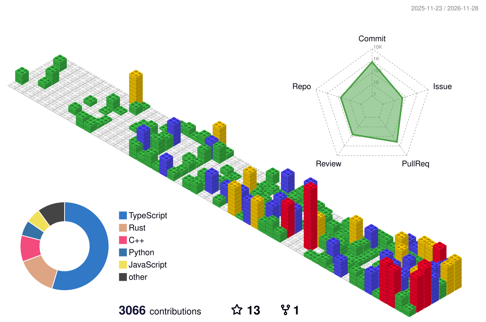

# Hi, I'm Kevin

Software engineer building systems tools, developer infrastructure, and AI agent workflows. Writing at [fdke.vin](https://fdke.vin).

## Projects

- **[anisette-server-rs](https://github.com/fdkevin0/anisette-server-rs)** — Rust Anisette V1/V3 server running Android, macOS, and Windows Apple ADI binaries under Unicorn Engine
- **[paseo-agy-acp](https://github.com/fdkevin0/paseo-agy-acp)** — Antigravity ACP provider for Paseo with native sessions, permissions, and rich tool timelines
- **[pi-agy-acp](https://github.com/fdkevin0/pi-agy-acp)** — Antigravity ACP provider extension for Pi Coding Agent
- **[mob](https://github.com/fdkevin0/mob)** — Personal AI assistant that runs locally on your machine
- **[skills](https://github.com/fdkevin0/skills)** — Agent skills and cross-CLI engineering rules for frontier coding agents
- **[gofile-dl-rs](https://github.com/fdkevin0/gofile-dl-rs)** — Batch directory and file downloader for Gofile in Rust

<picture>
  <source media="(prefers-color-scheme: dark)" srcset="https://raw.githubusercontent.com/fdkevin0/fdkevin0/output/profile-3d-contrib/profile-night-green.svg" />
  <source media="(prefers-color-scheme: light)" srcset="https://raw.githubusercontent.com/fdkevin0/fdkevin0/output/profile-3d-contrib/profile-gitblock.svg" />
  
</picture>
